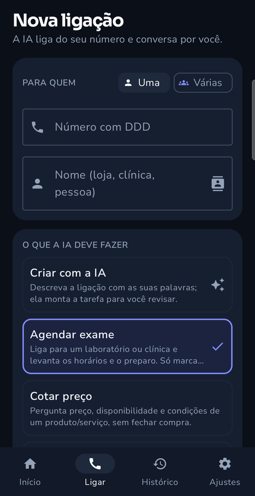
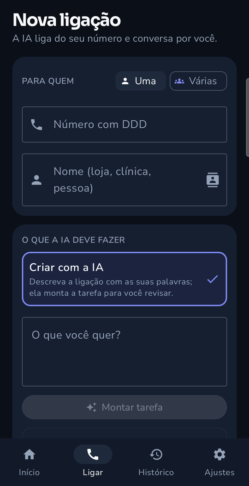
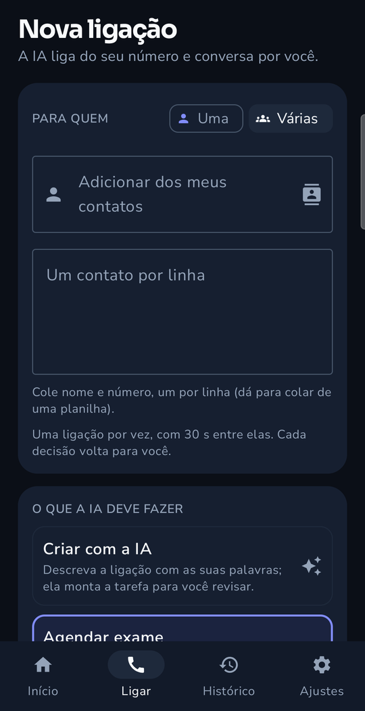
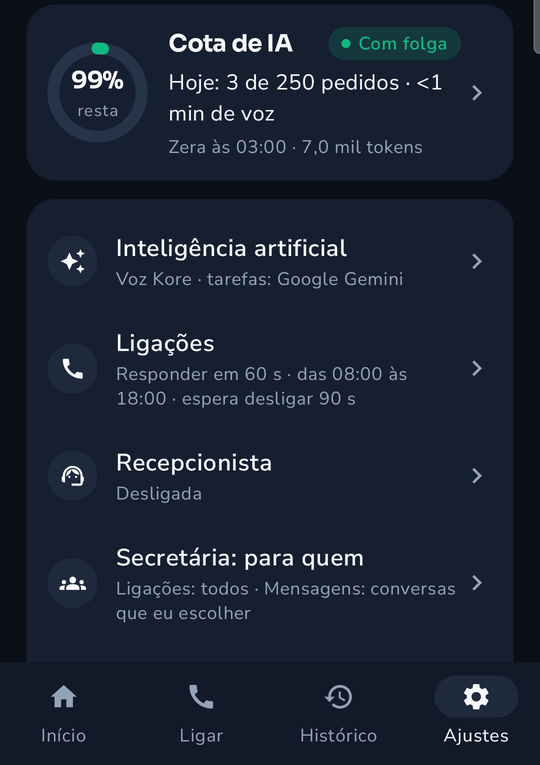
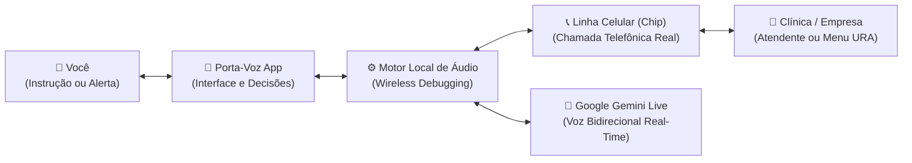

<h1 align="center">Porta-Voz</h1>

<p align="center">
  <strong>Assistente de voz com Inteligência Artificial para chamadas telefônicas reais pelo próprio celular</strong><br>
  Cota preços, agenda consultas, navega em menus automáticos e atende recados com supervisão humana estrita.
</p>

<p align="center">
  <a href="https://github.com/Yiuky/porta-voz/releases/latest"></a>
  
  
  
  <a href="PRIVACIDADE.md"></a>
  <a href="https://github.com/sponsors/Yiuky"></a>
  <a href="#-doe-um-café-para-o-dev"></a>
</p>

---

## 📱 Visão Geral

O **Porta-Voz** é um aplicativo Android que coloca uma secretária de inteligência artificial de verdade nas mãos de pessoas comuns (*Power to the people*). 

Em vez de você perder meia hora no telefone ouvindo música de espera para cotar um exame ou marcar uma consulta, a assistente **faz a ligação por você**:
- Liga pelo seu **próprio chip e plano móvel** (sem custos de telefonia em nuvem ou VoIP empresarial).
- Navega em menus eletrônicos automáticos (*"digite 1 para financeiro, 2 para agendamento"*).
- Negocia horários e tira dúvidas com atendentes humanos em voz natural de baixa latência.
- **Você tem sempre a palavra final:** se surgir um preço, um novo horário ou uma condição especial, ela pede um instante na ligação e pergunta na hora no seu celular (via notificação rápida de um toque). Nada é fechado sem a sua autorização expressa.

> [!NOTE]
> Esta é uma versão de testes distribuída via APK pelo GitHub enquanto o aplicativo é preparado para publicação na Google Play. O código-fonte do motor é proprietário.

---

## 📥 Baixar o Aplicativo

Acesse a página de **[Releases](https://github.com/Yiuky/porta-voz/releases/latest)** e escolha o arquivo:

| Arquivo APK | Descrição |
| :--- | :--- |
| **`Porta-Voz-0.3.0.apk`** | **Versão completa recomendada.** Suporta leitura do registro de chamadas e envio de SMS direto pela linha do usuário. |
| `Porta-Voz-0.3.0-loja.apk` | Versão adaptada para as políticas da Google Play (sem envio de SMS direto em segundo plano). |

### 🔒 Conferência de Integridade (SHA-256)
```text
a32375ac7a87ec6466d7b5e56f5bfa803ec28a02976d4150159b67454e217dfe  Porta-Voz-0.3.0.apk
1b4b5f520b089bf7379a56284b1ad8ba80818e966f28dd539e1c45611467a947  Porta-Voz-0.3.0-loja.apk
```

---

## 🖼️ Telas

<table>
  <tr>
    <td align="center"><br><b>Nova ligação</b><br>número, nome e o que a IA deve fazer</td>
    <td align="center"><br><b>Criar com a IA</b><br>descreva com as suas palavras e revise</td>
    <td align="center"><br><b>Várias ligações</b><br>cole os contatos; uma por vez</td>
    <td align="center"><br><b>Ajustes</b><br>cota de IA, voz, horários, recepcionista</td>
  </tr>
</table>

### A decisão volta para você

Ilustração com **dados fictícios** do momento em que a IA está na linha e pede a sua decisão.

<table>
  <tr>
    <td align="center"><br><b>Ao vivo</b><br>a IA pergunta antes de decidir</td>
    <td align="center"><br><b>Sua decisão</b><br>você escolhe; ela liga de volta</td>
  </tr>
</table>

---

## 🛠️ Arquitetura e Como Funciona

O Android por padrão impede que aplicativos convencionais capturem e injetem áudio digital diretamente dentro do fluxo de uma chamada telefônica ativa. Para contornar essa limitação **sem exigir root**, o Porta-Voz utiliza um motor local ativado via **Depuração Sem Fio (Wireless Debugging / ADB local)**:



1. **Áudio 100% Digital:** A voz da IA entra na ligação com clareza cristalina, e a voz do atendente é processada sem interferências de microfone físico ou ruídos do ambiente.
2. **Local-First & Direto:** O áudio trafega em tempo real criptografado diretamente do seu aparelho para a API do Google Gemini, utilizando a sua própria chave gratuita. Não há servidores intermediários nossos gravando ou processando a sua chamada.

---

## ✨ Principais Recursos

* 🎯 **Ligações com Objetivo:** Diga o que precisa (*"Ligue para a Mecânica X e pergunte se o orçamento do carro ficou pronto"*) e o app liga, dialoga e anota o resumo por escrito.
* 📋 **Ligações em Lote:** Faça a mesma cotação para 3 ou mais clínicas ou fornecedores em sequência e compare as respostas lado a lado.
* 🤖 **Navegação em Menus Eletrônicos (URA):** O app reconhece menus interativos de voz, envia os tons DTMF adequados (*"1", "2", "CPF"*), aprende os atalhos e avisa se o menu da empresa mudar.
* ✋ **Assumir a Ligação:** Você pode acompanhar a transcrição ao vivo na tela e, se preferir falar diretamente, assumir a chamada a qualquer momento com um toque.
* 🛎️ **Modo Recepcionista:** Atende chamadas recebidas quando você estiver ocupado, explica que você está indisponível e anota o recado completo com áudio e transcrição.
* 💬 **Secretária de Mensagens:** Suporte opcional para monitorar notificações e sugerir respostas rápidas para contatos autorizados (WhatsApp, Telegram e SMS).
* 📅 **Integração com Agenda:** A assistente pode consultar seus horários livres na agenda do celular para não marcar compromissos em horários conflitantes.
* 🎙️ **Ativação por Voz Offline:** Suporte à palavra de ativação *"Fala, Porta-Voz"* processada 100% localmente no aparelho.

---

## 🚀 Como Instalar e Configurar

### Requisitos:
* Aparelho com **Android 12** ou superior.
* Chip celular ativo com plano de voz para fazer ligações normais.
* Chave de API gratuita do **Google Gemini** (pegue em [aistudio.google.com/apikey](https://aistudio.google.com/apikey)).
* Conexão Wi-Fi ativa para a ativação inicial.

### Passo a Passo:

1. **Instale o APK:**
   * Baixe o [Porta-Voz-0.3.0.apk](https://github.com/Yiuky/porta-voz/releases/latest) no seu smartphone e autorize a instalação de fontes desconhecidas caso solicitado.
2. **Ative o Motor de Áudio (Pareamento único):**
   * Ative as *Opções do Desenvolvedor* no Android:
     `Configurações` → `Sobre o telefone` → `Informações do software` → Toque 7 vezes em **Número de compilação**.
   * Abra o Porta-Voz e toque em **Parear (uma vez)** no card do motor de áudio.
   * Nas configurações do sistema, ative a **Depuração sem fio** e escolha **Parear o dispositivo com um código**.
   * Digite o código de pareamento de 6 dígitos na notificação do Porta-Voz.
   > [!TIP]
   > Feito isso uma vez, o aplicativo reativa o motor automaticamente nas próximas inicializações sempre que conectado a uma rede Wi-Fi.
3. **Configure sua Chave:**
   * Insira seu nome e a sua chave da API Gemini (gratuita). Toque em **Testar** e confirme.
4. **Faça sua Primeira Chamada:**
   * Na aba **Início**, selecione ou digite o contato, informe o que deseja saber e toque em **Ligar agora**.

---

## 🔒 Privacidade e Segurança em Primeiro Lugar

O Porta-Voz foi concebido com governança e transparência estritas:

* 🚫 **Zero Servidores Próprios:** Não armazenamos seus contatos, suas conversas nem seus áudios. Não temos servidores em nuvem coletando metadados.
* 🔐 **Armazenamento Seguro:** Chaves de API e dados sensíveis são protegidos via hardware através do **Android Keystore**.
* 📢 **Transparência Legal:** A assistente se identifica expressamente como inteligência virtual no início da ligação e notifica sobre a gravação conforme as boas práticas legais.
* 📄 **Política Completa:** Leia o documento detalhado em [PRIVACIDADE.md](PRIVACIDADE.md).

---

## ⚠️ Observações da Versão de Testes

* **Migração para a Google Play:** Quando o app for disponibilizado oficialmente na Google Play Store, será necessário desinstalar a versão APK de testes prévia devido à assinatura de chaves de publicação da loja. Exporte suas conversas importantes pelo menu Histórico antes da troca.
* **Testes de Hardware:** O aplicativo foi testado em aparelhos Samsung Galaxy (com VoLTE ativo). Se encontrar comportamentos inesperados em outros fabricantes (Xiaomi, Motorola, etc.), use **Ajustes → Enviar diagnóstico** e abra uma [Issue](https://github.com/Yiuky/porta-voz/issues) relatando o modelo e a versão do sistema.

---

## ☕ Doe um café para o dev

Se o **Porta-Voz** economizou o seu tempo ou facilitou o seu dia a dia, considere apoiar o desenvolvimento independente: ajuda a manter os projetos abertos, gratuitos e evoluindo!

<table>
  <tr>
    <td align="center"></td>
    <td>
      <strong>Pix</strong> (qualquer valor)<br><br>
      Chave aleatória:<br>
      <code>fcf8071f-416d-49f1-b4b9-3188d3d03c4b</code><br><br>
      Pix copia e cola:<br>
      <code style="word-break: break-all;">00020101021126580014br.gov.bcb.pix0136fcf8071f-416d-49f1-b4b9-3188d3d03c4b5204000053039865802BR5917JOBERTH F GAMBATI6006CUIABA62070503***63048088</code><br><br>
      <em>Favorecido: Joberth Firmino Gambati</em>
    </td>
  </tr>
</table>

<p align="center">
  <a href="https://github.com/sponsors/Yiuky">
    
  </a>
</p>

---

## 👤 Autor e licença

- **Desenvolvedor:** Joberth Firmino Gambati ([@Yiuky](https://github.com/Yiuky))
- **Código-fonte:** privado, sem licença de código aberto. Este repositório distribui apenas os APKs de teste e a documentação.
- **APKs de teste:** distribuídos para avaliação; todos os direitos reservados ao autor. Privacidade: [PRIVACIDADE.md](PRIVACIDADE.md).
- Segurança: veja [SECURITY.md](SECURITY.md).

---

## 🌐 Conheça outros projetos do autor

O **Porta-Voz** faz parte do ecossistema de soluções de IA e automação desenvolvidas por **Joberth Gambati**:

* 🛰️ **[ArcMagery & QMagery](https://github.com/Yiuky/ArcMagery-releases):** Imagens de satélite direto no ArcMap e QGIS na resolução nativa.
* 🛡️ **[PrivioSentry](https://github.com/Yiuky/PrivioSentry):** Anonimização e tarjamento de PDFs com IA 100% offline (LGPD).
* 🗄️ **[ReperIO](https://github.com/Yiuky/ReperIO):** Indexador e copiador ultrarrápido para servidores de rede SMB/DFS.
* 🌍 **Portfólio Completo:** [yiuky.github.io](https://yiuky.github.io)
